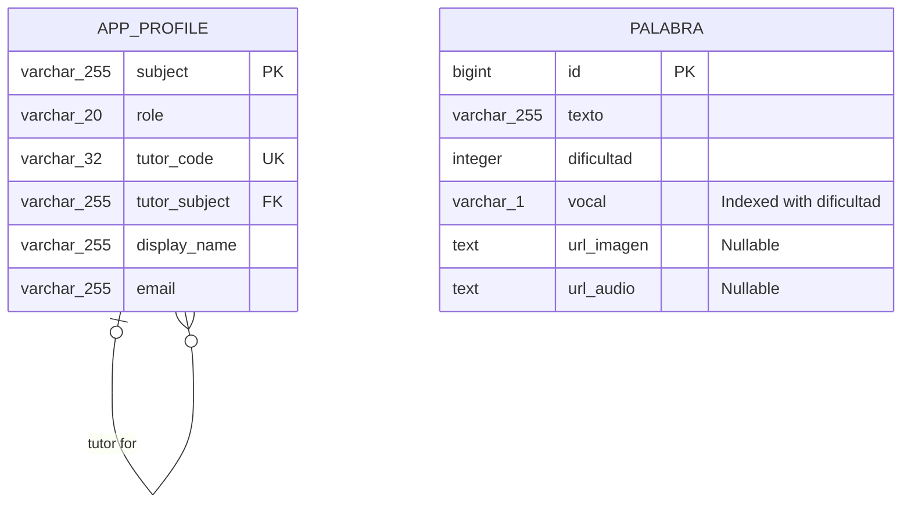

# Database entity relationships

The application tables are in PostgreSQL's `public` schema.

- Each word stores its letter and image and audio URLs directly. The `(vocal, dificultad)` index supports the content query. Either media URL can be null; the API still returns the word, and the client supplies a placeholder or tries device speech.
- A tutor has a unique `tutor_code` and no `tutor_subject`. A student has one `tutor_subject` referencing a tutor's `subject` and no `tutor_code`. The table's check constraints enforce the presence of these fields according to the role; the application checks that the referenced profile is a tutor.
- `subject` identifies the corresponding Keycloak account. Keycloak manages identity and credentials in its own `keycloak` schema; there is no database foreign key from `app_profile` to a Keycloak table.
- Learning progress is not stored in these tables. The vocabulary schema stores image and audio URLs, not the media files themselves.

The schema definitions are [001-schema.sql](../database/init/001-schema.sql) and [schema.sql](../backend/src/main/resources/schema.sql). For databases created with the previous schema, apply [002-merge-word-resources.sql](../database/migrations/002-merge-word-resources.sql) once. It preserves words without media and stops if a word has multiple resources, so those resources can be resolved before migration.

The app also has a separate SQLite database for local accounts and learning data. It mirrors the application-owned `palabra` and `app_profile` fields, adds password hashes to local profiles, stores completion summaries in `learning_event`, session metrics in `learning_session`, and individual answers in `learning_answer`. See [offline mode](offline-mode.md). These local tables are not synchronized with PostgreSQL.
